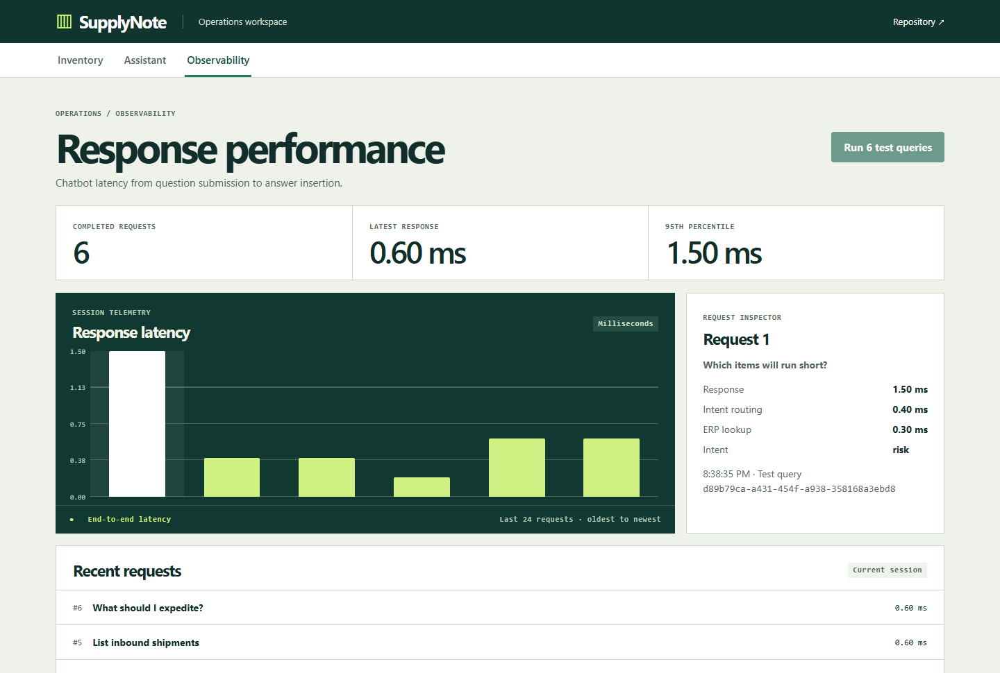

# SupplyNote

An inventory planning desk where a buyer can spot a shortage, ask when stock will arrive, and inspect the ERP records and execution trace behind the answer.

[Open the interactive demo](https://mohamadmirzaei79.github.io/SupplyNote/)



## Walk through a shortage

1. Select **Servo drive**. The warehouse starts with 42 units. Sales order SO-2041 commits 60, so the projected balance drops to −18 before the next delivery.
2. Ask **Which items will run short?** Then ask **When does it arrive?** to follow up on the item with the largest shortage. Open PO-1083 to inspect the 48-unit purchase from Vector Motion.
3. Open **Observability** and select a latency bar to inspect its question, intent, routing time, ERP lookup and trace ID. **Run 6 test queries** sends real, labeled requests through the current runtime. The chart shows the latest 24 completed requests in order. The p95 covers the whole page session and measures submission through answer insertion, including the HTTP round trip in API mode.

## Implementation

- **ERP** — The ledger combines on-hand quantities with open sales and purchase order lines. Receipts precede demand on the same day. The public demo ships fictional records for a single warehouse. The sum of peak deficits is an item-level planning indicator, not a simultaneous warehouse shortage.
- **AI chatbot** — A multinomial Naive Bayes classifier trained with scikit-learn routes English questions to shortage, receipt or balance calculations. Responses cite the source records and can carry an item into a follow-up question. Low-confidence matches return a help message. The assistant uses a small intent model and deterministic calculations; it requires no hosted model or API key.
- **Observability** — The browser demo measures each local inference and lookup. In server mode Node.js exposes JSON endpoints and Prometheus counters and a latency histogram at `/metrics`. Histogram values measure answer computation in seconds. Metric labels contain only the intent.

## Run locally

Requires Node.js 22 or newer. No npm install is required.

```sh
node --test test.mjs
node server.mjs
```

Open http://127.0.0.1:8080 for the API-backed desk. To inspect the metrics, send a question in the desk and open http://127.0.0.1:8080/metrics. The public GitHub Pages version runs entirely in the browser.

## Import an ERPNext export

Prepare a JSON object with arrays named `Bin`, `Sales Order` and `Purchase Order`, including each order's child items. See [the importer](import_erpnext.py) for field mapping. It selects a warehouse, uses remaining open quantities in stock units, and moves overdue lines to the snapshot date. Provide the actual export date.

```sh
python import_erpnext.py export.json --warehouse "Central stores" --as-of 2026-03-02 --output local-snapshot.json
ERP_SNAPSHOT=local-snapshot.json node server.mjs
```

The importer reads saved documents. Keep private exports outside the public repository. The local server defaults to loopback and has no authentication layer.

To retrain the bundled classifier, install scikit-learn and run `python train.py`. Its exported vocabulary and log probabilities are shared by both runtimes.
